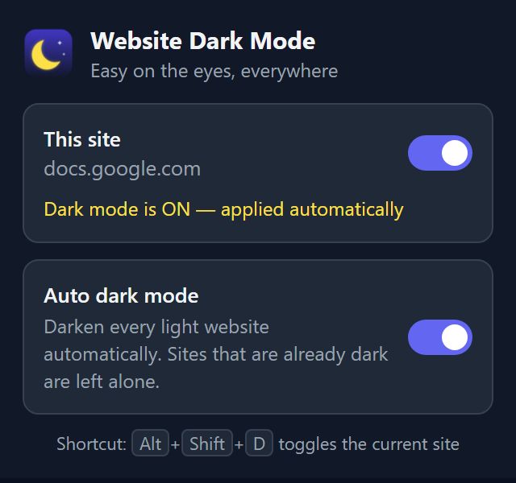

<p align="center">
  
</p>

<h1 align="center">Website Dark Mode – Chrome Extension</h1>

<p align="center">
  <b>Free dark mode Chrome extension for any website, with Auto dark mode.</b><br>
  Turn every light website dark to reduce eye strain at night. Works on Google Sheets, Google Docs, Gmail, Wikipedia, news sites, dashboards and more.<br>
  Only colors change. Fonts, font sizes and layout stay exactly the same.
</p>

<p align="center">
  
  
  
  
</p>

<p align="center">
  
</p>

## What it does

Website Dark Mode is a lightweight browser extension that turns bright, white websites dark. It was first built as a **Google Sheets dark mode** to stop spreadsheets from burning your eyes late at night, and it now works on **every website**.

- 🌙 **Dark mode on any website.** Click the toolbar icon and switch on dark mode for the site you're on. The choice is remembered per site.
- ⚡ **Auto dark mode.** Switch it on once and every light website you open goes dark automatically. Websites that already have a dark theme (YouTube, GitHub dark, etc.) are detected and left alone, so they don't get turned light.
- 📊 **Google Sheets and Google Docs dark mode.** Spreadsheet grids, cells, menus and toolbars all go dark. Cell colors keep their hue, so color-coded sheets still make sense.
- 🖼️ **Images and videos look normal.** Photos, logos, videos and embeds are kept in their real colors.
- 🔤 **No layout changes.** Unlike theme extensions that restyle pages, it only changes colors. Fonts, sizes and spacing stay the same.
- 🎯 **Per-site control.** Turn a site off even when Auto mode is on, and it stays off.
- ⌨️ **Keyboard shortcut.** `Alt+Shift+D` toggles dark mode on the current website.
- 🔒 **Private.** No accounts, no analytics, no network requests. Settings are stored only in your browser.

## Install

The extension is installed as an unpacked extension (Chrome Web Store listing coming later).

1. [Download this repository as a ZIP](https://github.com/rehmat-labs/website-dark-mode-chrome-extension/archive/refs/heads/main.zip) and unzip it, or clone it:
   ```bash
   git clone https://github.com/rehmat-labs/website-dark-mode-chrome-extension.git
   ```
2. Open `chrome://extensions` in Chrome (or `edge://extensions` in Microsoft Edge, `brave://extensions` in Brave).
3. Turn on **Developer mode** (top-right toggle).
4. Click **Load unpacked** and select the unzipped folder.
5. Pin the extension from the puzzle-piece menu so the moon icon is always visible.

## How to use

| You want to… | Do this |
| --- | --- |
| Make the current website dark | Click the moon icon → switch **This site** on |
| Make all light websites dark automatically | Click the moon icon → switch **Auto dark mode** on |
| Keep one website light while Auto mode is on | Open that site → switch **This site** off |
| Let Auto mode decide again for a site | Click **Let Auto mode decide for this site** in the popup |
| Toggle quickly without the popup | Press `Alt+Shift+D` (change it at `chrome://extensions/shortcuts`) |

The toolbar icon shows the state of each tab: a **yellow moon** means dark mode is on, a **grey moon** means it's off, and an **"A" badge** means Auto mode turned it on.

## How it works

The extension applies a CSS `invert(1) hue-rotate(180deg)` filter to the page. Inverting turns white backgrounds black and black text white, and the 180° hue rotation brings colors back to their original hue, so red stays red and blue stays blue. Images, videos and iframes get the same filter a second time, which cancels it out and keeps them looking normal.

Auto mode measures the background color at nine points on the screen and checks the text color to decide whether a page is light or already dark. It checks again after the page finishes loading, because many sites apply their theme late.

## FAQ

**Does it work on Google Sheets?**
Yes. It started as a Google Sheets dark mode extension. Because it works on whole pages rather than on one site's styles, Google Docs, Slides, Forms and Drive go dark the same way.

**Will it break websites that already have a dark theme?**
Not with Auto mode. Pages that are already dark are detected and left as they are. If you force dark mode on for a dark site yourself, it will turn light, and you can switch it off again for that site.

**Does it change fonts or text size?**
No. Only colors change.

**Does it collect any data?**
No. It has no analytics and makes no network requests. The only thing it stores is your on/off choice per website, in your browser's local extension storage.

**Why does a page sometimes flash white before going dark?**
With Auto mode, a page has to appear before its colors can be measured, so a light page may show for a moment. Sites you've turned on yourself go dark straight away.

**Which browsers are supported?**
Google Chrome, Microsoft Edge, Brave, Opera, Vivaldi and other Chromium browsers that support Manifest V3.

**Where doesn't it run?**
Browsers don't allow extensions on internal pages such as `chrome://` pages, the new tab page or the Chrome Web Store.

## Project files

| File | Purpose |
| --- | --- |
| `manifest.json` | Extension config (Manifest V3) |
| `content.js` | Decides per page whether to darken it, and applies or removes the filter |
| `background.js` | Updates the toolbar icon per tab and handles the keyboard shortcut |
| `popup.html`, `popup.css`, `popup.js` | The popup with the site switch and the Auto mode switch |
| `icons/` | Toolbar and store icons (`icon-*` = active, `icon-off-*` = inactive) |
| `tools/make_icons.py` | Regenerates the icons (`python tools/make_icons.py`, needs Pillow) |

## Contributing

Found a website that looks wrong in dark mode? [Open an issue](https://github.com/rehmat-labs/website-dark-mode-chrome-extension/issues) with the URL and a screenshot. Pull requests are welcome.

## Author

Made by **Rehmat Ullah** ([@rehmat-labs](https://github.com/rehmat-labs)).

## License

[MIT](LICENSE) © 2026 Rehmat Ullah
